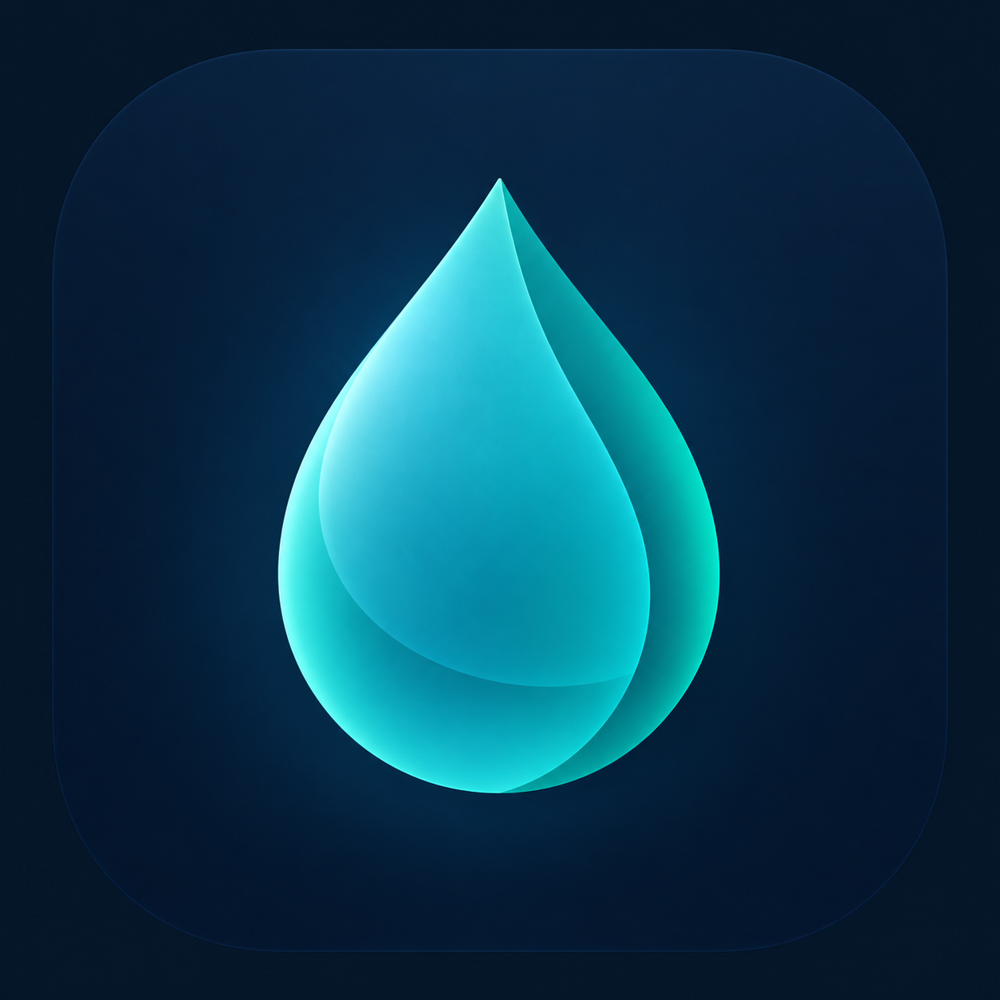

<p align="center">
  
</p>

<h1 align="center">Terso</h1>

<p align="center">
  <strong>Clean code, clean Mac.</strong><br/>
  The auditable macOS cleaner you don't have to trust — you can read it.
</p>

<p align="center">
  <a href="LICENSE"></a>
  
  <a href="https://github.com/lapht/terso-app/actions/workflows/ci.yml"></a>
  
</p>

---

## Why Terso?

Terso is an open-source macOS cleaner built around transparency, user control,
and cautious cleanup workflows. Its source and cleanup rules are available for
inspection, no subscription is required, and the project is designed to avoid
telemetry and unnecessary network access.

- 🔍 **Auditable** — cleanup rules are readable and can be reviewed before use
- 🛡️ **User-controlled** — review scan results and confirm cleanup actions
- 🗑️ **Cautious by design** — guarded deletion flows, dry-run support, and
  Trash-first cleanup
- 🔒 **Privacy-minded** — no account is required; privacy and data minimization
  are project goals, not a claim of absolute security
- 🧰 **Native** — SwiftUI app for macOS

> **Status:** Terso v0.1.0 is published and development continues. Cleanup
> software can select an item unexpectedly: review every selection, keep
> backups of important data, and do not treat guardrails as a guarantee against
> data loss. See the [release page](https://github.com/lapht/terso-app/releases)
> and [open issues](https://github.com/lapht/terso-app/issues) for current work.

## Features and status

| Status | Scope |
|---|---|
| **In the v0.1.0 source** | Scanning user caches and logs, Trash bins, Xcode and package-manager caches; read-only large-file scanning; Smart Scan; guarded cleanup and audit logging |
| **Planned** | App leftovers, duplicate-file detection, menu bar extra, localization, Homebrew distribution, and a read-only security configuration audit |
| **Manual release checks** | Full Disk Access behavior, case-sensitive APFS, non-English locale, and cleanup candidates staying within their allowlisted roots |

The feature list describes the release/source scope, not a claim that every
feature has been manually verified on every Mac. The manual checks above are
not run by the automated release workflow and should be completed by the
maintainer before publishing a release.

Further design details: [docs/design.md](docs/design.md).

## v0.1 — what's in this version

| Area | What it does | What it does **not** do |
|---|---|---|
| **Smart Scan** | Runs the v0.1 modules together only when you press the scan button, shows totals per module and keeps results when you switch pages | Never scans on launch, never deletes on its own |
| **User Caches** | Lists items under `~/Library/Caches` | Skips caches of running apps |
| **User Logs** | Lists rotated `.log` / `.gz` logs that match safe patterns | Does not touch active logs |
| **Trash Bins** | Shows what your Trash bins (home and mounted volumes) contain and how much space they use | — see beta test T-07 |
| **Xcode Junk** | Lists DerivedData, simulator caches and Xcode archives older than 90 days | Leaves recent archives alone |
| **Package caches** | Lists Homebrew, npm, yarn and pnpm caches | Runs no package-manager commands |
| **Large Files** | Lists the biggest files, with **Reveal in Finder** | Read-only: no delete button |
| **Cleanup** | Selection → recap (item count + total size) → confirmation → move to Trash → result screen | No permanent deletion in v0.1: items always go to the Trash |
| **Audit log** | Records every cleanup locally (time, rule, size) and lets you export it | Sends nothing anywhere |
| **Permissions** | Banner when Full Disk Access is missing; only the modules that need it are disabled | Does not require Full Disk Access to open the app |

Terso makes no network calls and collects no analytics.

## Beta testing v0.1

Thanks for helping. Please test on a Mac where you have a recent backup, and
**do not clean anything you are not sure about**: items go to the Trash, but
an app may still behave differently after its cache is removed.

Before you start, note your macOS version, chip (Apple Silicon or Intel) and
system language. Launch `Terso.app` from Finder, not from Xcode.

| ID | Test | Expected result |
|---|---|---|
| T-01 | First launch (Control-click > **Open** if macOS blocks it) | App opens; no scan starts by itself |
| T-02 | Launch **without** Full Disk Access | Permission banner visible; modules that need it are marked as blocked, others work; no per-folder "Allow" prompts storm |
| T-03 | Grant Full Disk Access in System Settings, return to Terso (relaunch if asked) | Banner disappears; blocked modules become available |
| T-04 | Run **Smart Scan** | Progress is visible; a total and a per-module breakdown appear; numbers look plausible |
| T-05 | Switch to another sidebar page and back | Scan results are still there |
| T-06 | Open each module page and run its scan | Each shows its own results or a clear "nothing found" / "permission needed" state — never a blank page |
| T-07 | **Trash Bins**: put a test file in the Trash, scan, try to clean it | Tell us exactly what happens (whether space is freed, whether the file is still in the Trash) |
| T-08 | Select a few cache items and press clean | Recap shows item count and total size **before** anything happens; Cancel changes nothing |
| T-09 | Confirm the cleanup | Items appear in the Finder Trash and can be put back; result screen matches the recap |
| T-10 | Open the audit log and export it | Each cleaned item is listed with time, rule and size; export produces a readable file |
| T-11 | **Large Files**: scan and press **Reveal in Finder** | Finder opens on the file; no delete option exists |
| T-12 | Xcode users: check **Xcode Junk** | DerivedData listed; archives younger than 90 days not listed |
| T-13 | Resize the window to its minimum, try light and dark mode | Sidebar stays fixed and top-aligned; one scroll area; text readable |
| T-14 | Non-English system language or case-sensitive APFS volume (if you have one) | Scans complete without errors |

Report each result (pass/fail + screenshots) in a
[bug report issue](https://github.com/lapht/terso-app/issues/new/choose).
Hide usernames and personal paths in screenshots and exported logs.

## Run Terso from source

**Runtime requirement:** macOS 13 or later. The app is developed with Xcode;
CI currently selects Xcode 16.4. `Terso.xcodeproj` contains the SwiftUI app and
uses the local `CoreKit` package defined by `Package.swift`.

```bash
git clone https://github.com/lapht/terso-app.git
cd terso-app
open Terso.xcodeproj
```

In Xcode, select the `TersoApp` scheme and press **⌘R** to build and launch.
The package alone is not the app target.

To build the app from the command line:

```bash
xcodebuild \
  -project Terso.xcodeproj \
  -scheme TersoApp \
  -configuration Debug \
  -destination 'platform=macOS' \
  CODE_SIGNING_ALLOWED=NO \
  build
```

Run the CoreKit Swift Package tests from the repository root with:

```bash
swift test -Xswiftc -strict-concurrency=complete -Xswiftc -warnings-as-errors
```

The app's unit tests are a separate Xcode test target:

```bash
xcodebuild \
  -project Terso.xcodeproj \
  -scheme TersoApp \
  -configuration Debug \
  -destination 'platform=macOS' \
  CODE_SIGNING_ALLOWED=NO \
  test
```

`swift test` does not run the app tests. CI runs both test commands, in
addition to its lint, format, build, and Safety Audit checks.

## Install the v0.1.0 release

Download `Terso-v0.1-macOS.zip` and
`Terso-v0.1-macOS.zip.sha256` from the
[v0.1.0 GitHub release](https://github.com/lapht/terso-app/releases/tag/v0.1.0).
The release tag is `v0.1.0`; the archive filenames are versioned `v0.1`.
Extract the ZIP to get `Terso.app`.

Verify the checksum in the directory containing both downloaded files:

```bash
shasum -a 256 -c Terso-v0.1-macOS.zip.sha256
```

The published v0.1.0 archive was checked: its checksum matches the sidecar,
its app bundle passes `codesign` verification, and its executable contains
both `arm64` and `x86_64`. Each future release must be checked independently;
do not infer its architectures from this release. The packaging script
ad-hoc signs the app and does not notarize it. Only install a release you
trust.

On first launch, macOS may require Control-click > **Open**, followed by
confirmation in the system dialog.

To build and package from source on macOS with Xcode installed:

```bash
./scripts/build-release.sh
```

The script requests both `arm64` and `x86_64` and creates
`dist/Terso-v0.1-macOS.zip` plus its SHA-256 sidecar. Verify the resulting
binary's architectures before distributing a locally built archive.

## Contributing

See [docs/CONTRIBUTING.md](docs/CONTRIBUTING.md). Changes to the safety layer
or cleanup rules need particular human review. Read [SECURITY.md](SECURITY.md)
before reporting a vulnerability or data-loss risk.

## License

Terso is licensed under the **GNU General Public License v3.0 or later**
([GPL-3.0-or-later](LICENSE)). The GPL permits commercial use and selling
copies. If you convey a modified version, you must meet the GPL's conditions,
including preserving notices, licensing the covered work under the GPL, and
providing or offering the corresponding source as required for the form of
distribution. See the license text for the exact terms; there is no requirement
that forks be free of charge.
