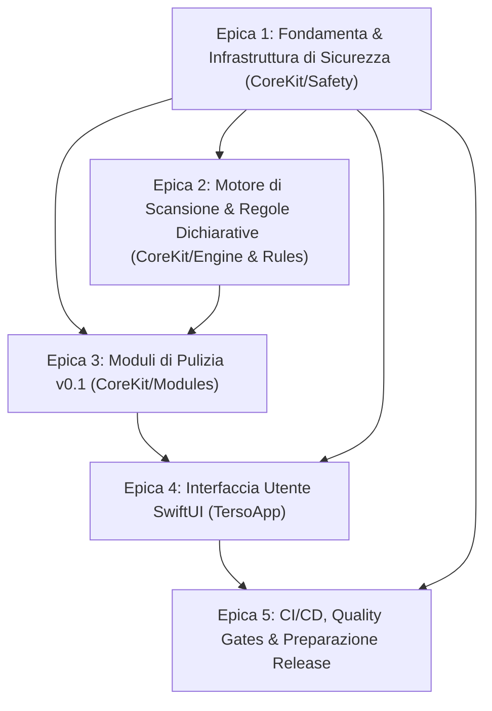

# Terso — Piano di Lavoro v0.1 (MVP)

_Progetto open source: Terso (macOS Cleaner) · Licenza: GPL-3.0 · Architettura: Swift 6 / SwiftUI_  
_Riferimento: `docs/design.md`_

---

## 1. Milestone: `v0.1 MVP`

### Descrizione
La versione **v0.1 (MVP)** costituisce la prima versione pubblica, auditable e funzionante di Terso. L'obiettivo primario è dimostrare la solidità dell'approccio *safety-first*, telemetry-free e zero-FUD: un cleaner per macOS trasparente, con logica interamente confinata in `CoreKit`, cancellazione centralizzata e protetta solo nel Cestino reale (*trash-first*), interfaccia SwiftUI nativa minimale e dry-run predefinito.

### Definizione di Done (DoD) della Milestone
Un'attività o release si considera completata solo se:
1. **Tutte le 8 Invarianti di Sicurezza** (§5 del design document) sono pienamente implementate, testate e verificate:
   - *Invariante 1*: Deletion solo su path allowlistate.
   - *Invariante 2*: Risoluzione symlink obbligatoria senza fughe esterne.
   - *Invariante 3*: Hard deny su percorsi protetti e app attive.
   - *Invariante 4*: Spostamento esclusivo nel Cestino reale (`trashItem`); nessuna cancellazione permanente in v0.1.
   - *Invariante 5*: Dry-run di default; Smart Scan non cancella mai al primo passaggio.
   - *Invariante 6*: Modale di conferma bloccante con conteggio elementi e dimensioni prima di agire.
   - *Invariante 7*: Gestione elegante dei permessi TCC / Full Disk Access senza scansioni parziali silenti.
   - *Invariante 8*: Audit log locale non silente di ogni operazione ed esportabilità del report.
2. **Architettura pulita**: Zero codice di cancellazione file al di fuori di `CoreKit/Safety`. Check statico in CI attivo e superato.
3. **Zero dipendenze runtime di terze parti**: Compilazione nativa pura Swift 6 / Foundation / SwiftUI su macOS 13+.
4. **Qualità del codice**: Nessun warning o errore da SwiftLint / SwiftFormat; conformità completa a Swift 6 strict concurrency (`Sendable`).
5. **Copertura test**: Unit test su engine e regole; integration test con directory fixture (inclusi symlink traversal attack); manual test su VM macOS pulita (con e senza Full Disk Access).
6. **Artefatti di rilascio**: Script di build ad-hoc funzionante, pacchetto `.zip` con app firmata ad-hoc, SHA256 e README aggiornato con screenshot.

---

## 2. Struttura delle Epiche

Le epiche sono organizzate secondo un rigoroso ordine di dipendenza architetturale: la **Safety Layer** viene realizzata e testata prima di qualsiasi modulo che produca elenchi di file pulibili.

- **Epica 1: Fondamenta & Infrastruttura di Sicurezza (`CoreKit/Safety`)**
  _Obiettivo:_ Creare la base del repository e la blindatura della pipeline di cancellazione prima di esporre qualunque funzionalità di rimozione.
- **Epica 2: Motore di Scansione & Regole Dichiarative (`CoreKit/Engine` & `CoreKit/Rules`)**
  _Obiettivo:_ Implementare il motore che carica il database di regole JSON, esegue il matching di pattern/glob e calcola accuratamente le dimensioni su disco.
- **Epica 3: Moduli di Pulizia v0.1 (`CoreKit/Modules`)**
  _Obiettivo:_ Implementare i 7 moduli specificati nel design document (§4) collegandoli all'engine e alla safety layer.
- **Epica 4: Interfaccia Grafica SwiftUI (`TersoApp`)**
  _Obiettivo:_ Realizzare la GUI nativa minimale per macOS (navigazione, Smart Scan, dettaglio moduli, modale di conferma e visualizzatore di log).
- **Epica 5: CI/CD, Quality Gates & Preparazione Release**
  _Obiettivo:_ Blindare la qualità con workflow automatizzati, audit di sicurezza statico, script di packaging ad-hoc e checklist di release.

## 3. Mappa Issues su GitHub & Registro User Stories

Tutte le storie sono tracciate come issue individuali su GitHub nel repository [`lapht/terso-app`](https://github.com/lapht/terso-app/issues).

| ID | Issue GitHub | Titolo | Epica | Modulo / Area | Stima | Dipendenze | Review Umana |
|:---|:---|:---|:---|:---|:---:|:---|:---:|
| **T0** | [#1](https://github.com/lapht/terso-app/issues/1) | Bootstrap repo, tooling, standard GPL-3.0 e AGENTS.md | Epica 1 | Root, CI, Docs | 2 | Nessuna | No |
| **T1** | [#2](https://github.com/lapht/terso-app/issues/2) | Modello dati di dominio CoreKit (CleanItem, ScanContext, VolumeInfo, CleanResult) | Epica 1 | `CoreKit/Engine/Models` | 2 | #1 (T0) | No |
| **T2** | [#3](https://github.com/lapht/terso-app/issues/3) | Safety Layer — Path Allowlist & Hard Deny Engine (Invarianti 1 & 3) | Epica 1 | `CoreKit/Safety` | 3 | #2 (T1) | **SÌ [SAFETY]** |
| **T3** | [#4](https://github.com/lapht/terso-app/issues/4) | Safety Layer — Risoluzione Symlink & Difesa da Traversal Attack (Invariante 2) | Epica 1 | `CoreKit/Safety` | 3 | #3 (T2) | **SÌ [SAFETY]** |
| **T4** | [#5](https://github.com/lapht/terso-app/issues/5) | Safety Layer — Deletion Pipeline & Trash-First Dispatcher (Invarianti 4 & 5) | Epica 1 | `CoreKit/Safety` | 5 | #4 (T3) | **SÌ [SAFETY]** |
| **T5** | [#6](https://github.com/lapht/terso-app/issues/6) | Safety Layer — Audit Logging Locale & Export Report (Invariante 8) | Epica 1 | `CoreKit/Safety` | 2 | #5 (T4) | **SÌ [SAFETY]** |
| **T6** | [#7](https://github.com/lapht/terso-app/issues/7) | CI Gate — Static Safety Audit AST/Grep Check | Epica 1 | `.github/scripts`, CI | 2 | #5 (T4) | **SÌ [SAFETY]** |
| **T7** | [#8](https://github.com/lapht/terso-app/issues/8) | CoreKit/Rules — Schema JSON v1 & Validatore Decodifica | Epica 2 | `CoreKit/Rules` | 2 | #2 (T1) | **SÌ (Rules)** |
| **T8** | [#9](https://github.com/lapht/terso-app/issues/9) | CoreKit/Engine — Rule Evaluation & Valutatore Glob/Pattern | Epica 2 | `CoreKit/Engine` | 3 | #3 (T2), #8 (T7) | No |
| **T9** | [#10](https://github.com/lapht/terso-app/issues/10) | CoreKit/Engine — Size Accounting & Calcolo Spazio APFS | Epica 2 | `CoreKit/Engine` | 2 | #2 (T1) | No |
| **T10** | [#11](https://github.com/lapht/terso-app/issues/11) | Database Iniziale delle Regole (Rules/v2026.1.json) | Epica 2 | `Rules/`, Tests | 2 | #8 (T7), #9 (T8) | **SÌ [SAFETY]** |
| **T11** | [#12](https://github.com/lapht/terso-app/issues/12) | Protocollo CleanModule & Gestore Graceful TCC (Invariante 7) | Epica 3 | `CoreKit/Modules` | 3 | #2 (T1), #3 (T2) | No |
| **T12** | [#13](https://github.com/lapht/terso-app/issues/13) | Modulo User Caches con Denylist App Attive (Invarianti 1 & 3) | Epica 3 | `CoreKit/Modules` | 3 | #9, #10, #11, #12 | No |
| **T13** | [#14](https://github.com/lapht/terso-app/issues/14) | Modulo User Logs con Safe Patterns | Epica 3 | `CoreKit/Modules` | 2 | #9, #10, #11, #12 | No |
| **T14** | [#15](https://github.com/lapht/terso-app/issues/15) | Modulo Trash Bins Multi-Volume | Epica 3 | `CoreKit/Modules` | 2 | #10 (T9), #12 (T11) | No |
| **T15** | [#16](https://github.com/lapht/terso-app/issues/16) | Modulo Xcode Junk (DerivedData, Archives, Simulator Caches) | Epica 3 | `CoreKit/Modules` | 2 | #9, #10, #11, #12 | No |
| **T16** | [#17](https://github.com/lapht/terso-app/issues/17) | Modulo Package Caches (Homebrew, npm, yarn, pnpm) | Epica 3 | `CoreKit/Modules` | 2 | #9, #10, #11, #12 | No |
| **T17** | [#18](https://github.com/lapht/terso-app/issues/18) | Modulo Large Files Scanner Read-Only (Reveal in Finder, No Deletion) | Epica 3 | `CoreKit/Modules` | 2 | #5 (T4), #10, #12 | No |
| **T18** | [#19](https://github.com/lapht/terso-app/issues/19) | Smart Scan Parallel Aggregator & Dry-Run Coordinator (Invariante 5) | Epica 3 | `CoreKit/Engine` | 3 | #13..#18 | No |
| **T19** | [#20](https://github.com/lapht/terso-app/issues/20) | UI Shell SwiftUI, Sidebar di Navigazione & TCC Banner (Invariante 7) | Epica 4 | `TersoApp/Views` | 3 | #12 (T11), #19 (T18) | No |
| **T20** | [#21](https://github.com/lapht/terso-app/issues/21) | UI — Vista Smart Scan & Dashboard di Riepilogo (Invariante 5) | Epica 4 | `TersoApp/Views` | 3 | #19 (T18), #20 (T19) | No |
| **T21** | [#22](https://github.com/lapht/terso-app/issues/22) | UI — Vista Dettaglio Modulo & Selezione Elementi | Epica 4 | `TersoApp/Views` | 3 | #20 (T19), #21 (T20) | No |
| **T22** | [#23](https://github.com/lapht/terso-app/issues/23) | UI — Modale di Conferma Pre-Esecuzione con Recap (Invariante 6) | Epica 4 | `TersoApp/Views` | 2 | #5 (T4), #22 (T21) | **SÌ [SAFETY]** |
| **T23** | [#24](https://github.com/lapht/terso-app/issues/24) | UI — Risultati Pulizia & Visualizzatore Audit Log (Invariante 8) | Epica 4 | `TersoApp/Views` | 2 | #6 (T5), #23 (T22) | No |
| **T24** | [#25](https://github.com/lapht/terso-app/issues/25) | CI/CD Matrix, Quality Gates & SwiftLint / SwiftFormat | Epica 5 | `.github/workflows` | 2 | #1 (T0), #7 (T6) | No |
| **T25** | [#26](https://github.com/lapht/terso-app/issues/26) | Checklist di Release v0.1 & Packaging Ad-Hoc | Epica 5 | `scripts/`, Release | 3 | #6, #7, #24, #25 | **SÌ [SAFETY]** |

---

### EPICA 1: Fondamenta & Infrastruttura di Sicurezza (`CoreKit/Safety`)

#### T0: Bootstrap repo, tooling, standard GPL-3.0 e AGENTS.md
- **Area:** Repository root, tooling, documentazione
- **Storia:** Come maintainer del progetto, voglio predisporre la struttura iniziale del repository, il package Swift, le regole di linting e la guida per agenti, così che lo sviluppo possa procedere in modo standardizzato, auditable e coerente.
- **Criteri di Accettazione:**
  - Intestazioni di licenza GPL-3.0 e identifier SPDX presenti in tutti i file modello e nel file `LICENSE`.
  - Struttura cartelle conforme a §3 del design document (`Sources/CoreKit/{Engine,Safety,Rules,Modules}`, `Sources/TersoApp`, `Rules/`, `Tests/Fixtures`, `docs/`).
  - `Package.swift` configurato con Swift 6, target `CoreKit` e `TersoApp`, con minimum deployment target macOS 13 (Ventura) e zero dipendenze runtime esterne.
  - File `.swiftlint.yml` configurato con regole rigorose per uniformità del codice generato da agenti.
  - File `AGENTS.md` compilato secondo le prescrizioni di §8: mappa dell'architettura, le 8 invarianti di sicurezza trascritte *verbatim*, divieto assoluto di logica di cancellazione fuori da `CoreKit/Safety`, convenzioni di commit (Conventional Commits), obbligo di review umana per PR su `Safety/` e `Rules/`.
  - Workflow GitHub Actions minimale (`.github/workflows/ci.yml`) che esegue compilazione, test e linting.
- **Checklist Test:**
  - `swift build` compila senza errori su macOS 13+.
  - `swift test` esegue la suite iniziale di test.
  - `swiftlint lint` passa con 0 warning e 0 errori.
- **Labels:** `type:infra`, `good-first-issue`
- **Dipendenze:** Nessuna
- **Stima:** 2 punti
- **Review umana richiesta:** No

---

#### T1: Modello dati di dominio CoreKit (`CleanItem`, `ScanContext`, `VolumeInfo`, `CleanResult`)
- **Area:** `Sources/CoreKit/Engine/Models`
- **Storia:** Come sviluppatore CoreKit, voglio definire i tipi e le strutture dati immutabili e thread-safe, così che lo scanner e la pipeline di sicurezza possano scambiare informazioni sui file con il pieno rispetto della strict concurrency di Swift 6.
- **Criteri di Accettazione:**
  - Definizione di `CleanItem`: `id: UUID`, `url: URL`, `resolvedURL: URL`, `sizeBytes: Int64`, `moduleId: String`, `ruleId: String`, `isProtected: Bool`, `recommendedAction: CleanAction`, conforme a `Identifiable`, `Sendable`, `Hashable`, `Codable`.
  - Definizione di `ScanContext`: directory home utente, array di volumi montati, flag `isDryRun`, set di esclusioni attive, stato TCC/FDA.
  - Definizione di `VolumeInfo`: metadati del volume (mount path, filesystem type, flag read-only, UUID).
  - Definizione di `CleanResult`: `itemsTrashed: [CleanItem]`, `bytesFreed: Int64`, `errors: [CleanError]`, `executionDuration: TimeInterval`.
  - Zero import di framework UI; piena conformità a `Sendable` in ambiente Swift 6 (`-strict-concurrency=complete`).
- **Checklist Test:**
  - Unit test di codifica e decodifica JSON di `CleanItem` e `CleanResult`.
  - Unit test che certificano l'assenza di data race e la conformità al protocollo `Sendable`.
- **Labels:** `type:feature`, `module:engine`
- **Dipendenze:** T0
- **Stima:** 2 punti
- **Review umana richiesta:** No

---

#### T2: Safety Layer — Path Allowlist & Hard Deny Engine (Invarianti 1 & 3)
- **Area:** `Sources/CoreKit/Safety/PathValidator.swift`
- **Storia:** Come utente di Terso, voglio che ogni operazione su un percorso sia rigidamente validata contro un'allowlist di root consentite e una denylist di sistema inviolabile, così che nessun file critico per il sistema o per l'utente possa mai essere toccato.
- **Criteri di Accettazione:**
  - **Invariante 1 (Allowlist-only roots)**: Qualsiasi percorso non strettamente sottostante alle root esplicitamente autorizzate per il modulo chiamante viene rigettato con `SafetyError.pathNotAllowlisted`.
  - **Invariante 3 (Protected paths)**: Hard deny non scavalcabile su: volumi SIP-protected, `/System`, `/private/var/db`, `/Library`, `/Applications`, radici delle cartelle personali (`~/Desktop`, `~/Documents`, `~/Downloads`) e bundle di applicazioni attive (`.app`).
  - Standardizzazione e normalizzazione preventiva del path (`URL.standardizedFileURL`), con gestione del case-folding (APFS case-insensitive vs case-sensitive).
  - Impossibilità di aggirare la validazione tramite path traversal (`..` o sequenze `./`).
- **Checklist Test:**
  - Unit test con matrice di path vietati (`/System/Library`, `/bin`, `~/Desktop`, `~/Documents/file.txt`).
  - Unit test con attacchi di path traversal (`~/Library/Caches/../../Desktop/secret.txt`).
  - Unit test con percorsi consentiti sotto le root dei moduli.
- **Labels:** `type:feature`, `module:safety`, `safety-critical`
- **Dipendenze:** T1
- **Stima:** 3 punti
- **Review umana richiesta:** **SÌ (tocca `Safety/`)**

---

#### T3: Safety Layer — Risoluzione Symlink & Difesa da Traversal Attack (Invariante 2)
- **Area:** `Sources/CoreKit/Safety/SymlinkValidator.swift`
- **Storia:** Come utente di Terso, voglio che la pipeline di sicurezza risolva ogni symlink e verifichi che la destinazione reale rimanga confinata all'interno della root consentita, così da prevenire attacchi via symlink a file sensibili.
- **Criteri di Accettazione:**
  - **Invariante 2 (Symlink discipline)**: Risoluzione obbligatoria di ogni symlink tramite `URL.resolvingSymlinksInPath()`.
  - Verifica che il target reale risolto rispetti l'allowlist root del modulo e non violi i percorsi protetti (Invariante 3).
  - Divieto tassativo di seguire symlink verso posizioni esterne: se il target è al di fuori dell'allowlist, l'elemento viene escluso e scartato con `SafetyWarning.externalSymlinkTarget`.
  - Gestione robusta di symlink ciclici e broken symlinks senza crash o loop infiniti.
- **Checklist Test:**
  - Integration test con fixture di filesystem contenente:
    - Symlink diretto verso `/etc/passwd`.
    - Symlink diretto verso `~/Documents`.
    - Symlink circolare (A -> B -> A).
    - Symlink broken (target inesistente).
  - Asserzione che tutti i target non autorizzati vengano intercettati e rifiutati.
- **Labels:** `type:feature`, `module:safety`, `safety-critical`
- **Dipendenze:** T2
- **Stima:** 3 punti
- **Review umana richiesta:** **SÌ (tocca `Safety/`)**

---

#### T4: Safety Layer — Deletion Pipeline & Trash-First Dispatcher (Invarianti 4 & 5)
- **Area:** `Sources/CoreKit/Safety/DeletionPipeline.swift`
- **Storia:** Come utente di Terso, voglio che l'unico meccanismo di cancellazione nell'intera applicazione sposti i file nel Cestino reale e supporti la modalità dry-run, così da poter sempre recuperare i file eliminati e prevedere esattamente l'impatto prima di agire.
- **Criteri di Accettazione:**
  - **Invariante 4 (Trash-first)**: L'unica operazione distruttiva eseguita è `FileManager.default.trashItem(at:resultingItemURL:)` verso il Cestino del volume corrispondente.
  - Nessuna API di cancellazione permanente (`removeItem`) è esposta o consentita nella v0.1.
  - **Invariante 5 (Dry-run everywhere)**: Ogni operazione accetta `dryRun: Bool`. Se `dryRun == true`, nessun file viene modificato o spostato sul filesystem; la pipeline simula l'operazione restituendo elementi e byte che verrebbero liberati.
  - Ogni elemento viene obbligatoriamente validato con `PathValidator` (T2) e `SymlinkValidator` (T3) immediatamente prima dell'azione.
  - `DeletionPipeline` è l'UNICA classe nell'intero progetto che invoca API di modifica file.
- **Checklist Test:**
  - Integration test su directory fixture temporanea: verifica che con `dryRun: true` nessun file venga spostato o toccato.
  - Integration test di spostamento nel Cestino (`dryRun: false`) con verifica del `resultingItemURL`.
  - Test di rifiuto immediato in caso di path non autorizzata senza alcuna interazione sul filesystem.
- **Labels:** `type:feature`, `module:safety`, `safety-critical`
- **Dipendenze:** T3
- **Stima:** 5 punti
- **Review umana richiesta:** **SÌ (tocca `Safety/`)**

---

#### T5: Safety Layer — Audit Logging Locale & Export Report (Invariante 8)
- **Area:** `Sources/CoreKit/Safety/AuditLogger.swift`
- **Storia:** Come utente e maintainer, voglio che ogni azione di cancellazione o simulazione sia registrata localmente con timestamp, rule ID e dimensione, così che tutte le operazioni siano verificabili ed esportabili per trasparenza o segnalazione bug.
- **Criteri di Accettazione:**
  - **Invariante 8 (No silent failures)**: Log locale strutturato in formato JSON Lines (UTF-8) memorizzato in `~/Library/Logs/Terso/audit.log`.
  - Ogni record di log include: `timestamp` ISO 8601, `action` (trash/dryRun), `moduleId`, `ruleId`, `originalPath`, `resolvedPath`, `sizeBytes`, `result` (success/failure con codice errore).
  - Nessun dato personale o contenuto del file viene registrato (solo path, metadati e dimensione).
  - Funzione `AuditLogger.exportReport(to: URL)` per esportare il log corrente in formato leggibile per bug report.
- **Checklist Test:**
  - Unit test che verificano il formato dei record scritti nel log.
  - Test di gestione degli errori di I/O (directory di log protetta o non accessibile).
  - Test della funzione di esportazione del report.
- **Labels:** `type:feature`, `module:safety`, `safety-critical`
- **Dipendenze:** T4
- **Stima:** 2 punti
- **Review umana richiesta:** **SÌ (tocca `Safety/`)**

---

#### T6: CI Safety Audit Gate — Check Statico Anti-Bypass della Deletion
- **Area:** `.github/scripts/safety-audit.sh`, `.github/workflows/ci.yml`
- **Storia:** Come maintainer, voglio un controllo automatizzato in CI che fallisca la build se qualunque file fuori da `CoreKit/Safety` invoca API di rimozione file, così da prevenire regressioni architetturali o bypass della safety layer.
- **Criteri di Accettazione:**
  - Script bash/swift che analizza l'albero dei sorgenti per chiamate a `removeItem`, `trashItem`, `unlink`, `remove`, invocazioni POSIX o chiamate a processi shell di eliminazione (`rm`).
  - Tolleranza consentita: unicamente e tassativamente all'interno della directory `Sources/CoreKit/Safety/`.
  - Fallimento bloccante (exit code 1) se viene individuata qualsiasi invocazione vietata in `Sources/CoreKit/Engine`, `Sources/CoreKit/Modules`, `Sources/TersoApp`, ecc.
  - Integrazione dello script come gate obbligatorio nel workflow CI di GitHub Actions.
- **Checklist Test:**
  - Test dello script su file fittizio non conforme: deve fallire segnalando il file e la riga incriminata.
  - Esecuzione dello script sull'albero sorgente pulito: esito positivo con exit code 0.
- **Labels:** `type:infra`, `module:safety`, `safety-critical`
- **Dipendenze:** T4
- **Stima:** 2 punti
- **Review umana richiesta:** **SÌ (tocca `Safety/` e CI)**

---

### EPICA 2: Motore di Scansione & Regole Dichiarative (`CoreKit/Engine` & `Rules`)

#### T7: Schema Regole JSON v1 & Validatore Decodifica
- **Area:** `Sources/CoreKit/Rules/RuleModel.swift`, `RuleValidator.swift`
- **Storia:** Come contributore alle regole di pulizia, voglio definire uno schema JSON formale per le regole con validazione a tempo di decodifica, così da garantire che le regole siano dichiarative, sicure e prive di errori sintattici o semantici.
- **Criteri di Accettazione:**
  - Tipi `Codable`: `RuleDatabase` (version, schemaVersion, rules), `CleanupRule` (id, module, category, name, description, allowlistRoots, paths, patterns, exclusions, minAgeSeconds, isTrashSafe).
  - Validazione semantica da parte di `RuleValidator`: rigetto di regole con root vuote, root generiche (`/`, `~`, `/System`), ID duplicati o pattern regex non validi.
  - Rifiuto controllato di JSON malformati con messaggi d'errore descrittivi, senza crash dell'applicazione.
- **Checklist Test:**
  - Unit test con file JSON conformi allo schema v1.
  - Unit test con regole invalide (root vietata, ID duplicato, pattern corrotto) che accertano il fallimento controllato della validazione.
- **Labels:** `type:feature`, `module:rules`, `good-first-issue`
- **Dipendenze:** T1
- **Stima:** 2 punti
- **Review umana richiesta:** **SÌ (tocca `Rules/`)**

---

#### T8: Rule Engine & Valutatore di Pattern / Glob
- **Area:** `Sources/CoreKit/Engine/RuleEvaluator.swift`, `GlobMatcher.swift`
- **Storia:** Come sviluppatore del motore, voglio un motore di valutazione di regole e glob pattern performante e sicuro, così da identificare accuratamente i file candidati alla pulizia filtrando esclusioni e condizioni temporali.
- **Criteri di Accettazione:**
  - Supporto completo per pattern glob standard (`*`, `**`, `?`, `*.log`, ecc.).
  - Valutazione della lista `exclusions`: esclusione immediata dei path corrispondenti anche se catturati da un glob positivo.
  - Valutazione di `minAgeSeconds`: esclusione di file creati o modificati più recentemente della soglia definita.
  - Integrazione preventiva con `PathValidator` di Safety (T2) per ogni file individuato.
- **Checklist Test:**
  - Unit test con combinazioni di pattern glob su directory di test in-memory/temporanee.
  - Test per regole con esclusioni complesse e nidificate.
  - Test per filtri su data di modifica (`minAgeSeconds`).
- **Labels:** `type:feature`, `module:engine`
- **Dipendenze:** T2, T7
- **Stima:** 3 punti
- **Review umana richiesta:** No

---

#### T9: Size Accounting & Calcolo Spazio APFS
- **Area:** `Sources/CoreKit/Engine/SizeCalculator.swift`
- **Storia:** Come utente, voglio visualizzare le dimensioni reali dei file e delle cartelle candidate alla rimozione, così da sapere con precisione quanto spazio su disco verrà liberato.
- **Criteri di Accettazione:**
  - Calcolo ricorsivo rapido della dimensione di directory e singoli file tramite `URLResourceKey.fileAllocatedSizeKey` e `fileSizeKey`.
  - Gestione corretta dei file con hard links e file sparsi (sparse files) per evitare conteggi doppi.
  - Rilevazione e gestione sicura di file con permessi limitati senza interrompere il calcolo complessivo.
  - Helper di formattazione human-readable nativo basato su `ByteCountFormatter`.
- **Checklist Test:**
  - Unit test di calcolo dimensione su file singoli di dimensione nota.
  - Integration test su albero di directory fixture con file annidati e verifica del conteggio byte esatto.
- **Labels:** `type:feature`, `module:engine`
- **Dipendenze:** T1
- **Stima:** 2 punti
- **Review umana richiesta:** No

---

#### T10: Database Iniziale delle Regole (`Rules/v2026.1.json`)
- **Area:** `Rules/v2026.1.json`, `Tests/RulesTests/`
- **Storia:** Come maintainer di Terso, voglio disporre del database dichiarativo iniziale delle regole per i moduli v0.1 validato da snapshot test, così che i moduli possano operare su percorsi certificati e sicuri.
- **Criteri di Accettazione:**
  - Creazione del file `Rules/v2026.1.json` con metadati e regole per:
    - User Caches (app allowlisted sotto `~/Library/Caches`).
    - User Logs (`~/Library/Logs`, file `.log`, `.gz`, `.crash`, rotazioni vecchie).
    - Xcode Junk (`~/Library/Developer/Xcode/DerivedData`, archives cache, simulator caches).
    - Package caches (Homebrew cache `~/Library/Caches/Homebrew`, npm cache `~/.npm`, yarn, pnpm).
  - Tutte le regole specificano `allowlistRoots` ristrette e `isTrashSafe: true`.
  - Snapshot test `RuleDatabaseSnapshotTests` che valida il file JSON contro lo schema e previene modifiche non tracciate nelle PR.
- **Checklist Test:**
  - Test di validazione automatica del database `v2026.1.json`.
  - Snapshot test del JSON in `Tests/`.
- **Labels:** `type:feature`, `module:rules`, `safety-critical`
- **Dipendenze:** T7, T8
- **Stima:** 2 punti
- **Review umana richiesta:** **SÌ (tocca `Rules/`)**

---

### EPICA 3: Moduli di Pulizia v0.1 (`CoreKit/Modules`)

#### T11: Protocollo `CleanModule` & Gestione Graceful TCC (Invariante 7)
- **Area:** `Sources/CoreKit/Modules/CleanModule.swift`, `TCCManager.swift`
- **Storia:** Come sviluppatore di moduli, voglio un protocollo unificato `CleanModule` e un gestore dello stato TCC/Full Disk Access, così che ogni modulo possa scansionare in sicurezza e disabilitarsi con grazia se i permessi non sono concessi.
- **Criteri di Accettazione:**
  - Protocollo `CleanModule` conforme a §3: `id: String`, `title: String`, `requiresFDA: Bool`, `func scan(context: ScanContext) async throws -> [CleanItem]`.
  - Assenza tassativa del metodo `clean()` nel protocollo: i moduli individuano i file, la cancellazione avviene unicamente tramite la pipeline di Safety.
  - **Invariante 7 (Graceful TCC)**: Rilevazione trasparente dello stato Full Disk Access tramite check di lettura non invasivo su path protetto da TCC. Se FDA manca, i moduli che lo richiedono vengono disabilitati con stato esplicito `requiresPermission` e messaggio chiaro; l'app non esegue mai scansioni parziali silenti.
- **Checklist Test:**
  - Unit test con mock di contesti TCC (FDA concesso vs FDA negato).
  - Test che certifica che un modulo che richiede FDA non tenti la scansione se non autorizzato.
- **Labels:** `type:feature`, `module:modules`, `safety-critical`
- **Dipendenze:** T1, T2
- **Stima:** 3 punti
- **Review umana richiesta:** No

---

#### T12: Modulo User Caches con Denylist App Attive (Invarianti 1 & 3)
- **Area:** `Sources/CoreKit/Modules/UserCachesModule.swift`
- **Storia:** Come utente, voglio identificare i file di cache delle applicazioni in `~/Library/Caches`, escludendo automaticamente le app attualmente in esecuzione, così da liberare spazio senza causare instabilità software.
- **Criteri di Accettazione:**
  - Scansione confinata rigorosamente a `~/Library/Caches` (Invariante 1).
  - Rilevazione delle applicazioni macOS attualmente in esecuzione tramite `NSWorkspace.shared.runningApplications`.
  - Denylist dinamica: esclusione immediata della cartella cache appartenente a qualsiasi bundle ID attualmente in esecuzione (Invariante 3).
  - Generazione di `CleanItem` con dimensione calcolata e flag di sicurezza.
  - Nessuna invocazione diretta di cancellazione (ritorna solo lista `[CleanItem]`).
- **Checklist Test:**
  - Fixture integration test con finta directory `~/Library/Caches` contenente cache di app aperte e chiuse.
  - Verifica che la cartella dell'app aperta venga ignorata e quella dell'app chiusa sia inclusa.
- **Labels:** `type:feature`, `module:caches`
- **Dipendenze:** T8, T9, T10, T11
- **Stima:** 3 punti
- **Review umana richiesta:** No

---

#### T13: Modulo User Logs con Safe Patterns
- **Area:** `Sources/CoreKit/Modules/UserLogsModule.swift`
- **Storia:** Come utente, voglio scansionare i file di log utente obsoleti e ruotati in `~/Library/Logs`, così da ripulire gigabyte di file diagnostici non più necessari.
- **Criteri di Accettazione:**
  - Scansione limitata a `~/Library/Logs`.
  - Corrispondenza solo su pattern sicuri e file ruotati (`*.log.[0-9]+`, `*.log.gz`, `*.crash`, `*.diag`).
  - Esclusione dei log correntemente aperti in scrittura o modificati di recente (`minAgeSeconds` di default a 24 ore).
  - Verifica symlink rigorosa: nessun symlink fuori da `~/Library/Logs` seguito (Invariante 2).
- **Checklist Test:**
  - Fixture test con file di log recenti vs log ruotati compressi.
  - Verifica che solo i log conformi alle regole vengano restituiti.
- **Labels:** `type:feature`, `module:logs`, `good-first-issue`
- **Dipendenze:** T8, T9, T10, T11
- **Stima:** 2 punti
- **Review umana richiesta:** No

---

#### T14: Modulo Trash Bins Multi-Volume
- **Area:** `Sources/CoreKit/Modules/TrashBinsModule.swift`
- **Storia:** Come utente, voglio visualizzare e svuotare il contenuto del Cestino dell'utente su tutti i volumi montati, così da recuperare lo spazio occupato da file già cestinati in precedenza.
- **Criteri di Accettazione:**
  - Rilevazione del Cestino principale dell'utente (`~/.Trash`).
  - Rilevazione dei cestini utente sui volumi esterni montati (`/Volumes/*/.Trashes/<uid>`).
  - Calcolo accurato della dimensione totale degli elementi nel Cestino.
  - Restituzione degli elementi per la visualizzazione all'utente.
- **Checklist Test:**
  - Integration test con directory fixture che emula `~/.Trash` e `/Volumes/External/.Trashes/501`.
  - Verifica del corretto conteggio degli elementi e della dimensione complessiva.
- **Labels:** `type:feature`, `module:trash`
- **Dipendenze:** T9, T11
- **Stima:** 2 punti
- **Review umana richiesta:** No

---

#### T15: Modulo Xcode Junk (DerivedData, Archives, Simulator Caches)
- **Area:** `Sources/CoreKit/Modules/XcodeJunkModule.swift`
- **Storia:** Come sviluppatore Apple, voglio individuare i file temporanei generati da Xcode (DerivedData, cache di archivi e simulatori), così da recuperare decine di gigabyte di build artifacts accumulati.
- **Criteri di Accettazione:**
  - Scansione sicura dei target specifici:
    - `~/Library/Developer/Xcode/DerivedData`
    - `~/Library/Developer/Xcode/Archives` (cache temporanee o progetti rimossi)
    - `~/Library/Developer/CoreSimulator/Caches`
  - Controllo che Xcode non sia in esecuzione (se Xcode è aperto, DerivedData viene escluso o contrassegnato con warning).
  - Raggruppamento degli elementi per progetto/cartella con calcolo delle dimensioni per singolo progetto.
- **Checklist Test:**
  - Fixture test con finta directory `DerivedData` e simulatore di processo Xcode attivo.
  - Verifica del calcolo delle dimensioni per singolo target di build.
- **Labels:** `type:feature`, `module:xcode`
- **Dipendenze:** T8, T9, T10, T11
- **Stima:** 2 punti
- **Review umana richiesta:** No

---

#### T16: Modulo Package Caches (Homebrew, npm, yarn, pnpm)
- **Area:** `Sources/CoreKit/Modules/PackageCachesModule.swift`
- **Storia:** Come sviluppatore, voglio ripulire le cache di download dei gestori di pacchetti (Homebrew, npm, yarn, pnpm), così da eliminare archivi di pacchetti già installati.
- **Criteri di Accettazione:**
  - Individuazione delle sole directory di cache note e allowlisted:
    - Homebrew: `~/Library/Caches/Homebrew`
    - npm: `~/.npm/_cacache`
    - Yarn: `~/Library/Caches/Yarn` o `~/.cache/yarn`
    - pnpm: `~/Library/Caches/pnpm`
  - Nessuna invocazione di tool CLI esterni (solo ispezione delle cartelle di cache del filesystem, coerente con "zero runtime dependencies").
  - Verifica che non vengano toccati file di configurazione (`.npmrc`, lockfile, formule locali).
- **Checklist Test:**
  - Fixture test con directory di cache pacchetti simulate.
  - Verifica che solo le sottocartelle di cache siano individuate e che i file di configurazione siano intatti.
- **Labels:** `type:feature`, `module:packages`
- **Dipendenze:** T8, T9, T10, T11
- **Stima:** 2 punti
- **Review umana richiesta:** No

---

#### T17: Modulo Large Files Scanner Read-Only (Reveal in Finder, No Deletion)
- **Area:** `Sources/CoreKit/Modules/LargeFilesModule.swift`
- **Storia:** Come utente, voglio trovare i file di grandi dimensioni nella mia home directory e poterli rivelare nel Finder, senza che il modulo ne consenta la cancellazione diretta da Terso.
- **Criteri di Accettazione:**
  - Scansione read-only configurabile (default: file > 100 MB).
  - Scansione limitata a directory utente non di sistema (esclusione categorica di `/System`, `/Library`, `/private`).
  - Tutti gli elementi restituiti hanno la proprietà `isDeletable = false` e azione predefinita `revealInFinder`.
  - Impossibilità di passare questi elementi alla pipeline di cancellazione (bloccati dal validatore di safety).
- **Checklist Test:**
  - Unit test con file fittizi di varie dimensioni (< 100MB e > 100MB).
  - Verifica che gli elementi abbiano `isDeletable == false` e che qualsiasi tentativo di passarli a `DeletionPipeline` generi rifiuto immediato.
- **Labels:** `type:feature`, `module:largefiles`
- **Dipendenze:** T4, T9, T11
- **Stima:** 2 punti
- **Review umana richiesta:** No

---

#### T18: Smart Scan Parallel Aggregator & Dry-Run Coordinator (Invariante 5)
- **Area:** `Sources/CoreKit/Engine/SmartScanAggregator.swift`
- **Storia:** Come utente, voglio lanciare una scansione intelligente con un solo clic che esegua i moduli abilitati in parallelo e in totale sicurezza, visualizzando un'anteprima senza alcuna cancellazione accidentale.
- **Criteri di Accettazione:**
  - **Invariante 5 (Dry-run everywhere)**: Il primo passaggio di "Smart Scan" opera ESCLUSIVAMENTE in modalità dry-run / read-only.
  - Esecuzione concorrente dei moduli registrati tramite Swift Concurrency (`TaskGroup`), gestendo la cancellazione cooperativa del task se l'utente interrompe la scansione.
  - Notifica progressiva dello stato di avanzamento (modulo corrente, percentuale/conteggio item, byte trovati).
  - Isolamento dei fallimenti: se un modulo genera errore, gli altri continuano e l'errore viene aggregato senza far crashare la scansione.
- **Checklist Test:**
  - Unit test dell'aggregatore con mock module veloci e mock module lenti.
  - Test di cancellazione del task a metà esecuzione.
  - Test di resilienza con un modulo che lancia eccezione.
- **Labels:** `type:feature`, `module:engine`, `safety-critical`
- **Dipendenze:** T12, T13, T14, T15, T16, T17
- **Stima:** 3 punti
- **Review umana richiesta:** No

---

### EPICA 4: Interfaccia Grafica SwiftUI (`TersoApp`)

#### T19: UI Shell SwiftUI, Sidebar di Navigazione & TCC Banner (Invariante 7)
- **Area:** `Sources/TersoApp/Views/MainShellView.swift`, `SidebarView.swift`, `TCCBannerView.swift`
- **Storia:** Come utente macOS, voglio un'interfaccia SwiftUI nativa e minimale con una sidebar per navigare tra i moduli e un banner chiaro se mancano i permessi Full Disk Access.
- **Criteri di Accettazione:**
  - Finestra nativa macOS 13+ con `NavigationSplitView` (sidebar a sinistra con icone native SF Symbols e lista moduli; vista dettagli a destra).
  - Voci nella sidebar: "Smart Scan", "User Caches", "User Logs", "Trash Bins", "Xcode Junk", "Package Caches", "Large Files", "Audit Logs".
  - **Invariante 7 (Graceful TCC)**: Banner informativo non invasivo in cima alla vista quando manca Full Disk Access, con pulsante "Open System Settings" che guida l'utente a concedere i permessi se desiderato, senza forzature.
  - Rispetto rigoroso dello stile visivo macOS (Human Interface Guidelines).
- **Checklist Test:**
  - SwiftUI View test / Preview test per stato con e senza permessi FDA.
  - Test navigazione sidebar tra i vari moduli.
- **Labels:** `type:feature`, `module:gui`
- **Dipendenze:** T11, T18
- **Stima:** 3 punti
- **Review umana richiesta:** No

---

#### T20: UI — Vista Smart Scan & Dashboard di Riepilogo (Invariante 5)
- **Area:** `Sources/TersoApp/Views/SmartScanView.swift`
- **Storia:** Come utente, voglio visualizzare la schermata principale di Smart Scan con il pulsante "Scan", una barra di progresso fluida e le schede riassuntive dei risultati per categoria.
- **Criteri di Accettazione:**
  - Stato iniziale: pulsante prominente "Scan" (Smart Scan) con spiegazione che la scansione è completamente sicura e non modifica alcun file (Invariante 5).
  - Stato di scansione: indicatore di progresso animato, nome del modulo attualmente in scansione, contatore progressivo di file trovati e gigabyte liberabili.
  - Stato di completamento scansione: card riassuntive per ciascun modulo con dimensione totale liberabile e numero di elementi trovati.
  - Pulsante disabilitato o sostituito da "Cancel" durante l'esecuzione della scansione.
- **Checklist Test:**
  - Test dello stato del ViewModel (`idle`, `scanning`, `finished`, `cancelled`).
- **Labels:** `type:feature`, `module:gui`, `good-first-issue`
- **Dipendenze:** T18, T19
- **Stima:** 3 punti
- **Review umana richiesta:** No

---

#### T21: UI — Vista Dettaglio Modulo & Selezione Elementi
- **Area:** `Sources/TersoApp/Views/ModuleDetailView.swift`, `ItemRowView.swift`
- **Storia:** Come utente, voglio ispezionare gli elementi trovati da ciascun modulo, selezionare o deselezionare singoli file e aprire la loro posizione nel Finder, così da avere pieno controllo su cosa verrà rimosso.
- **Criteri di Accettazione:**
  - Lista dettagliata con checkbox di selezione per elemento/gruppo (tutti selezionati per default nei moduli pulibili; deselezionati se non raccomandati).
  - Ogni riga mostra: nome file/cartella, percorso relativo, dimensione formattata, icona del file.
  - Menu contestuale con opzione "Reveal in Finder".
  - Nel modulo Large Files: nessuna checkbox di cancellazione, solo pulsante/azione "Reveal in Finder".
- **Checklist Test:**
  - Test del ViewModel di selezione (toggle singolo, select all, deselect all, ricalcolo dimensione totale selezionata).
- **Labels:** `type:feature`, `module:gui`
- **Dipendenze:** T19, T20
- **Stima:** 3 punti
- **Review umana richiesta:** No

---

#### T22: UI — Modale di Conferma Pre-Esecuzione con Recap (Invariante 6)
- **Area:** `Sources/TersoApp/Views/ConfirmationSheetView.swift`
- **Storia:** Come utente, voglio visualizzare un riepilogo dettagliato del conteggio elementi e della dimensione totale prima di qualsiasi spostamento nel Cestino, così da confermare consapevolmente l'operazione.
- **Criteri di Accettazione:**
  - **Invariante 6 (Confirmation + recap)**: Modale di conferma bloccante prima di avviare l'azione di pulizia.
  - Visualizzazione chiara e non ambigua: "Verranno spostati nel Cestino N elementi per un totale di X.XX GB".
  - Messaggio rassicurante: "Tutti gli elementi saranno spostati nel Cestino e potranno essere ripristinati in qualunque momento".
  - Nessuna opzione di cancellazione permanente disponibile nella v0.1.
  - Due azioni chiare: "Annulla" (dismiss) e "Sposta nel Cestino" (procedi).
- **Checklist Test:**
  - Test di presentazione della sheet e verifica che la pipeline di cancellazione non parta mai senza il click esplicito su conferma.
- **Labels:** `type:feature`, `module:gui`, `safety-critical`
- **Dipendenze:** T4, T21
- **Stima:** 2 punti
- **Review umana richiesta:** **SÌ (tocca flussi legati alla Safety)**

---

#### T23: UI — Risultati Pulizia & Visualizzatore Audit Log (Invariante 8)
- **Area:** `Sources/TersoApp/Views/CleanResultView.swift`, `AuditLogView.swift`
- **Storia:** Come utente, voglio vedere la schermata di successo con lo spazio effettivamente liberato e poter consultare o esportare il log delle operazioni effettuate, così da verificare cosa è stato spostato nel Cestino.
- **Criteri di Accettazione:**
  - Schermata di riepilogo finale: totale byte liberati, tempo impiegato, eventuali avvisi non bloccanti.
  - Vista dedicata "Audit Log" accessibile dalla sidebar con tabella delle operazioni recenti (timestamp, regola, percorso, esito).
  - Pulsante "Export Audit Log" per salvare il file di log o visualizzarlo nel Finder (Invariante 8).
- **Checklist Test:**
  - Test di formattazione della schermata di successo con dati mock.
  - Test del pulsante di esportazione log.
- **Labels:** `type:feature`, `module:gui`, `good-first-issue`
- **Dipendenze:** T5, T22
- **Stima:** 2 punti
- **Review umana richiesta:** No

---

### EPICA 5: CI/CD, Quality Gates & Preparazione Release

#### T24: CI/CD Matrix, Quality Gates & SwiftLint / SwiftFormat
- **Area:** `.github/workflows/ci.yml`, `.swiftlint.yml`
- **Storia:** Come maintainer, voglio una pipeline di Continuous Integration robusta che compili e testi il codice su macOS 13+ con Swift 6 strict concurrency, linting e safety audit, così da garantire la qualità e sicurezza di ogni PR.
- **Criteri di Accettazione:**
  - Workflow GitHub Actions eseguito su PR e push su `main`.
  - Runner macOS (arm64 e x86_64).
  - Step 1: Linting con SwiftLint e controllo formattazione SwiftFormat.
  - Step 2: Compilazione con flag di strict concurrency (`-warnings-as-errors`).
  - Step 3: Esecuzione di tutti gli unit e integration test.
  - Step 4: Esecuzione dello script di Safety Audit (T6).
  - Regola di branch protection documentata: tutti i check devono passare prima del merge.
- **Checklist Test:**
  - Esecuzione con successo del workflow in ambiente CI.
  - Simulazione di fallimento se un test o lint fallisce.
- **Labels:** `type:infra`
- **Dipendenze:** T0, T6
- **Stima:** 2 punti
- **Review umana richiesta:** No

---

#### T25: Checklist di Release v0.1 & Packaging Ad-Hoc
- **Area:** `.github/workflows/release.yml`, `scripts/build-release.sh`, `README.md`
- **Storia:** Come release manager, voglio uno script di build ad-hoc riproducibile, una procedura di packaging ZIP per GitHub Releases e una checklist di verifica pre-rilascio, così da pubblicare la v0.1 MVP in modo trasparente e collaudato.
- **Criteri di Accettazione:**
  - Script `scripts/build-release.sh` che compila TersoApp in configurazione Release, crea l'app bundle (`Terso.app`), applica firma ad-hoc (`codesign -s -`) e impacchetta in `Terso-v0.1-macOS.zip`.
  - Workflow GitHub Actions manuale o su tag `v0.1*` per creare la GitHub Release allegando lo ZIP e calcolando lo SHA256.
  - Checklist di rilascio completata e verificata:
    1. Esecuzione e superamento dei test su VM pulita macOS (senza Full Disk Access inizialmente, poi con FDA).
    2. Test su volume APFS case-sensitive.
    3. Test con locale di sistema non inglese.
    4. Verifica che nessuno spostamento avvenga fuori da allowlist.
    5. README.md aggiornato con screenshot reali dell'interfaccia, istruzioni di avvio (apertura app con firma ad-hoc) e badge di build.
- **Checklist Test:**
  - Test locale dello script di packaging: generazione valida dell'archivio zip contenente l'app bundle funzionante.
- **Labels:** `type:infra`, `safety-critical`
- **Dipendenze:** T5, T6, T23, T24
- **Stima:** 3 punti
- **Review umana richiesta:** **SÌ (Release gate)**

---

## 4. Backlog per v0.2+ (Post-MVP)
Come da §4 e §9 del design document, le seguenti funzionalità sono escluse dalla v0.1 per preservare l'integrità dell'MVP:
- **Modulo App Leftovers / Uninstaller**: rimozione file residui di app cancellate.
- **Modulo Duplicates Finder**: identificazione e deduplica file identici.
- **Menu Bar Extra**: icona nella barra di stato macOS per monitoraggio e scan rapido.
- **Localizzazione**: supporto multilingua (Italiano + Inglese prioritari).
- **Homebrew Tap**: distribuzione automatizzata via formula cask.
- **terso-cli**: wrapper a riga di comando per CoreKit.
- **Config Audit**: Gatekeeper, FileVault e SIP status inspector (v1.0).
